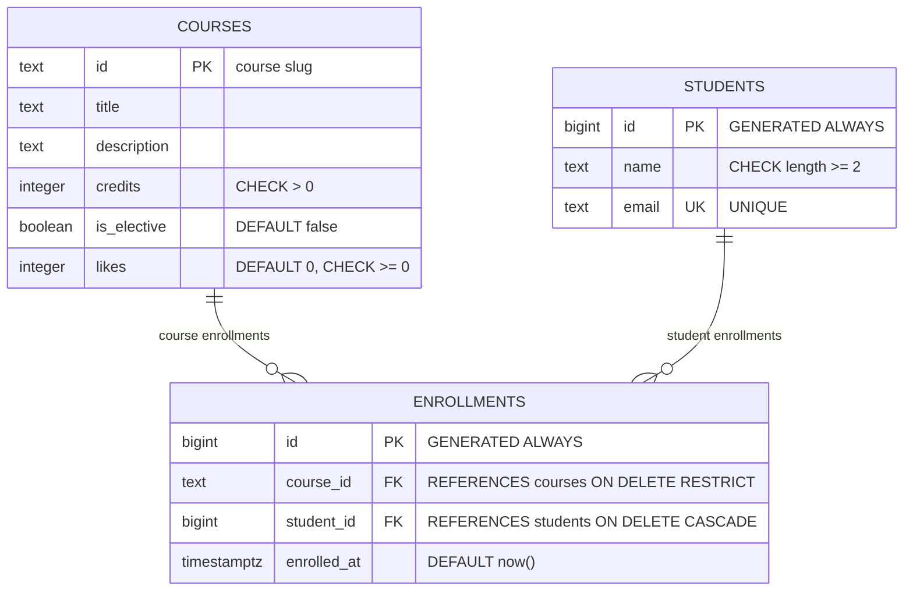

# course-catalog-db

PostgreSQL schema for the course catalog (Lab 6, "Advanced Web Technologies").

---

## How to run

PostgreSQL 16 or newer is required. Once, as the `postgres` superuser:

```sql
CREATE ROLE catalog_app LOGIN PASSWORD 'change-me';
CREATE DATABASE course_catalog OWNER catalog_app;
CREATE DATABASE idx_demo        OWNER catalog_app;
CREATE DATABASE norm_demo       OWNER catalog_app;
```

Then, from the project folder (stops at the first error):

```bash
psql -h localhost -U catalog_app -d course_catalog -v ON_ERROR_STOP=1 -f schema.sql
psql -h localhost -U catalog_app -d course_catalog -v ON_ERROR_STOP=1 -f seed.sql
psql -h localhost -U catalog_app -d course_catalog -v ON_ERROR_STOP=1 -f queries.sql
```

The password `change-me` is for teaching only; real projects keep passwords out of git.

---

## Schema



Three tables: **courses** stores the catalog, **students** stores registered users, and **enrollments** links them in a many-to-many relationship — one course can have many students and one student can enroll in many courses. The `enrollments` table is the junction table that resolves the many-to-many into two one-to-many relationships.

---

## Design decisions

- **`courses.id` is text (a slug) while `students.id` is an auto number.**
  A course slug like `web-security` is human-readable and stable — it can appear in URLs and never needs to change. A student has no natural stable identifier, so an auto-generated number is the right choice. The trade-off: slugs require more care (no spaces, unique by convention), while auto numbers just work but are meaningless outside the database.

- **`RESTRICT` on `enrollments.course_id` but `CASCADE` on `enrollments.student_id`.**
  Deleting a course that still has students enrolled is most likely a mistake — `RESTRICT` forces you to handle enrollments first. Deleting a student, on the other hand, should clean up all their data automatically; `CASCADE` does that without extra queries.

- **`timestamptz` instead of `timestamp`, and `text` instead of `varchar(n)`.**
  `timestamptz` stores the moment in UTC and converts to the client's time zone on output, so the value is correct regardless of where the server or the user is located. `timestamp` has no time-zone information and silently gives the wrong time when the server moves. `text` in PostgreSQL has no performance or storage penalty over `varchar(n)` — the length limit in `varchar(n)` is a domain rule that belongs in a `CHECK` constraint where it is visible, not hidden in the type name.

---

## Constraint violation log

Commands were run with `\set VERBOSITY verbose`.

| # | What we violate | SQLSTATE | Constraint | API response |
|---|-----------------|----------|------------|--------------|
| 1 | NULL in `courses.title` | 23502 | column `title` (NOT NULL has no name) | 422 — Pydantic should catch this first; if it doesn't, it's a bug → 500 |
| 2 | `courses.credits = 0` | 23514 | `courses_credits_check` | 422 |
| 3 | `courses.likes = -1` | 23514 | `courses_likes_check` | 500 — only our code changes likes; a negative value means a bug |
| 4 | one-letter student name | 23514 | `students_name_check` | 422 |
| 5 | duplicate student email | 23505 | `students_email_key` | 409 Conflict |
| 6 | duplicate course id | 23505 | `courses_pkey` | 409 Conflict |
| 7 | repeated enrollment | 23505 | `enrollments_course_id_student_id_key` | 409 Conflict |
| 8 | enroll in nonexistent course | 23503 | `enrollments_course_id_fkey` | 404 — course not found |
| 9 | enroll nonexistent student | 23503 | `enrollments_student_id_fkey` | 404 — student not found |
| 10 | delete course with enrollments | 23001 | `enrollments_course_id_fkey` | 409 Conflict — course has enrollments |
| 11 | delete student (CASCADE) | — | no error; enrollments deleted automatically | — enrollments: 6 → 3 → 6 after ROLLBACK |

**Why check in the database if Pydantic already checks?**
Pydantic runs inside the FastAPI process, but the database can be written to by other sources — migration scripts, admin tools, another microservice, or a developer running a direct SQL query. The database constraint is the last line of defense: it enforces the rule unconditionally, no matter who writes the data. Pydantic gives a good error message to the API client; the database constraint guarantees the data is never corrupt.

---

## Index: EXPLAIN before and after

Query: `SELECT * FROM enrollments WHERE student_id = 777;`

Database `idx_demo`: 500 courses, 20,000 students, 50,000 enrollments.

| | Before the index | After the index |
|---|---|---|
| Access method | `Seq Scan on enrollments` | `Bitmap Heap Scan` → `Bitmap Index Scan on enrollments_student_id_idx` |
| cost | `0.00..1042.00` | `4.31..15.59` |
| Rows Removed by Filter | 49,997 | 0 (uses index) |
| Execution Time | ~3–5 ms | ~0.05–0.1 ms |

**Plan before the index:**
```
Seq Scan on enrollments  (cost=0.00..1042.00 rows=3 width=34)
  Filter: (student_id = 777)
  Rows Removed by Filter: 49997
```

**Plan after the index:**
```
Bitmap Heap Scan on enrollments  (cost=4.31..15.59 rows=3 width=34)
  Recheck Cond: (student_id = 777)
  ->  Bitmap Index Scan on enrollments_student_id_idx  (cost=0.00..4.31 rows=3 width=0)
        Index Cond: (student_id = 777)
```

**Answers:**

1. **Why didn't PostgreSQL create an index on `enrollments.student_id` automatically?**
   PostgreSQL automatically creates indexes for `PRIMARY KEY` and `UNIQUE` constraints, but not for `FOREIGN KEY`. The foreign key only requires that the referenced value exists — that check goes against the primary key of the parent table (`students.id`), which already has an index. The child column (`student_id`) is not indexed unless you create the index yourself.

2. **Why does a primary-key lookup on `courses` (6 rows) use `Seq Scan`, while on `enrollments` (50,000 rows) it goes through an index?**
   The planner compares estimated costs. A 6-row table fits on a single data page; reading that one page (cost ≈ 1.07) is cheaper than the overhead of going through an index (reading the index page, then the data page). On a 50,000-row table the sequential scan cost is ~1042, while the index path costs ~15 — so the planner chooses the index.

3. **Two operations that the index on `student_id` speeds up:**
   - `SELECT * FROM enrollments WHERE student_id = ?` — the query used in `GET /enrollments` filtered by student, and in the cascade-delete check.
   - `DELETE FROM students WHERE id = ?` with `ON DELETE CASCADE` — when a student is deleted, PostgreSQL must find and delete all their enrollment rows; without the index it scans the whole table.

---

## Transaction

Scenario: enroll a new student in a course — two inserts in one transaction.

**The second insert failed (nonexistent course):**
After the first `INSERT INTO students` succeeded, the second `INSERT INTO enrollments` with `course_id = 'no-such-course'` raised error `23503` (foreign key violation). The prompt changed to `=!>` — the transaction was aborted. Every subsequent command, including a harmless `SELECT`, was rejected with "current transaction is aborted, commands ignored until end of transaction block". After `ROLLBACK`, the student row was gone too — both inserts were undone together. No orphaned student (a student with no enrollment) was left in the database.

**Window B saw `count = 0` before COMMIT and `count = 1` after COMMIT.**
While window A had an open transaction with both inserts done but not yet committed, window B queried the same table and got zero rows. The changes were invisible to other connections. The moment window A ran `COMMIT`, the next query in window B returned 1 — both the student and the enrollment appeared at the same time.

**Without a transaction:** if the second insert had failed after the first one committed, the database would have been left with a student who has no enrollment — "half an operation". The data would be inconsistent and there would be no automatic way to clean it up.

---

## Self-review against the checklist

| What to check | Result |
|---|---|
| Keys | ✅ Every table has a primary key. Foreign keys on `enrollments.course_id` → `courses(id)` and `enrollments.student_id` → `students(id)`. |
| Types | ✅ `bigint` for auto IDs, `text` for strings, `integer` for counts/credits, `boolean` for flags, `timestamptz` for timestamps. |
| Required values | ✅ All meaningful columns are `NOT NULL`. `enrolled_at` has a default and is `NOT NULL`. |
| Constraints | ✅ `CHECK (credits > 0)`, `CHECK (likes >= 0)`, `CHECK (length(name) >= 2)`, `UNIQUE (email)`, `UNIQUE (course_id, student_id)`. Match Pydantic rules. |
| Deletion | ✅ `RESTRICT` on course_id (can't delete a course with enrollments — deliberate), `CASCADE` on student_id (delete student → delete their enrollments — deliberate). |
| Normalization | ✅ Each fact is stored once. No repeated groups. Courses, students, and enrollments are separate tables. |
| Indexes and names | ✅ `enrollments_student_id_idx` added for the FK. All names are snake_case. No unnecessary indexes. |
